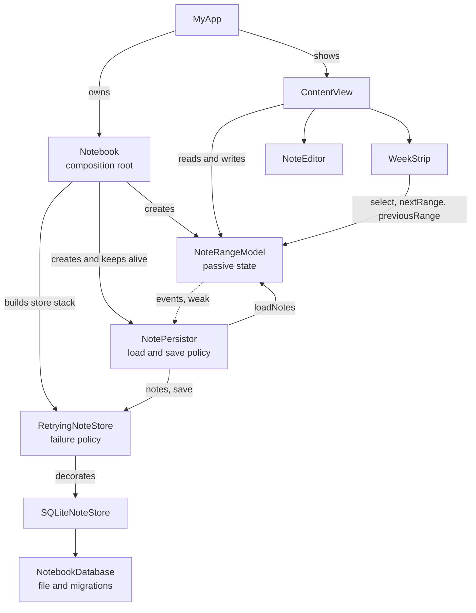
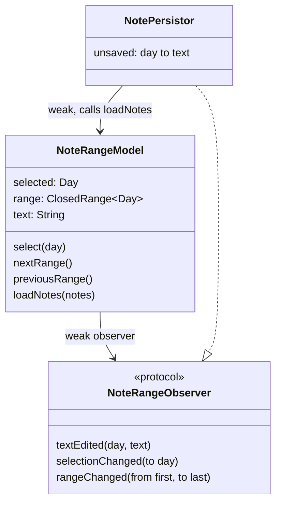
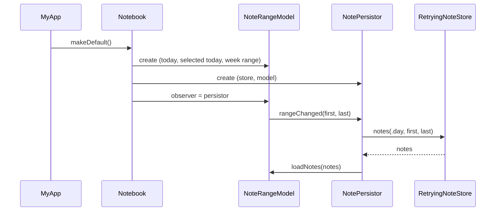
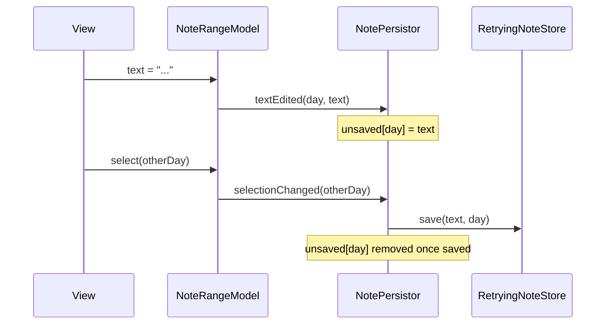
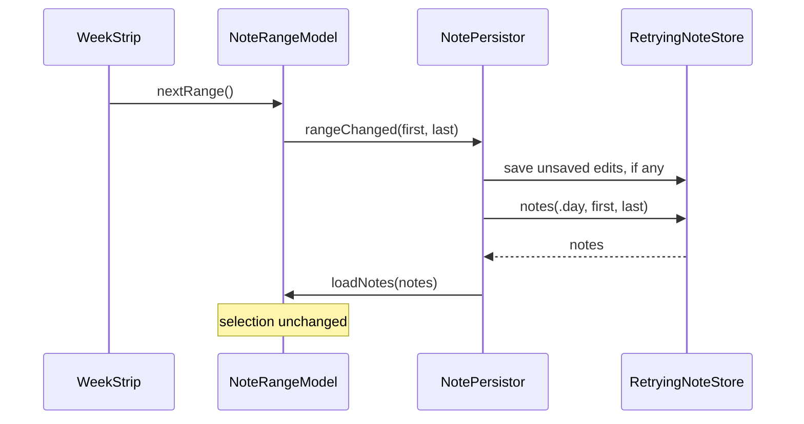
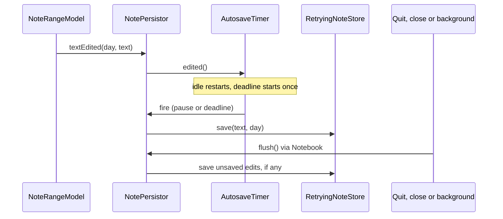

# Architecture

How Everline is put together, and why. Only the significant structure is here: who owns what, who talks to whom, and the
flows that cross those boundaries. Product intent is in `PRD.md` and `MVP.md`; the day-to-day commands and conventions
are in `CLAUDE.md`.

## Principles

- **A passive model.** `NoteRangeModel` holds state and announces changes. It never loads, saves, retries or schedules.
- **Policy lives in one place.** `NotePersistor` decides when to load and save. `RetryingNoteStore` decides what a
  failure means. Neither the model nor the views know about either.
- **Everything storage-specific is behind `NoteStore`.** SQLite and GRDB appear only in `everline/SQLite/`.
- **Wiring is explicit.** `Notebook` is the one place that builds and connects the parts. There is no global state.
- **No visual terms below the views.** The model talks about a selected day and a range of days, not strips, weeks on
  screen or highlights.

## Components

| Part                  | Responsibility                                                                             |
| --------------------- | ------------------------------------------------------------------------------------------ |
| `Notebook`            | Builds model, persistor and store stack, attaches the observer, keeps both alive.          |
| `NoteRangeModel`      | Today, the selected day, a range of days, the notes of that range plus the selected day.   |
| `NotePersistor`       | Keeps unsaved edits; writes them on a move, pause or exit, retries failures; loads ranges. |
| `RetryingNoteStore`   | Retries a failed store call, then runs the give-up handler (the app crashes on purpose).   |
| `NoteStore`           | The protocol notes live behind: `notes(scope:from:to:)` and `save(_:for:)`.                |
| `SQLiteNoteStore`     | Plain SQL over GRDB. One note per scope and period; saving empty text deletes the row.     |
| `NotebookDatabase`    | Opens the file (`EVERLINE_DIR` can move it) and runs the numbered SQL migrations.          |
| `ContentView` and co. | SwiftUI shell. `NoteEditor` wraps `NSTextView` or `UITextView` behind one binding.         |

## The model and its observer

The model and the persistor are the heart of the design. They reference each other, but in different ways: the model
holds its observer weakly and only announces; the persistor holds the model weakly and answers by calling
`loadNotes`.

- Events are synchronous and carry their data, so the receiver never reads the model while it is mid-change. By the
  time `nextRange()` returns, the new range is already loaded.
- **Selection and range are separate.** Paging moves the range and keeps the selection, which may then lie outside the
  range. Selecting a day outside the range moves the range to that day.
- Attaching an observer reports the current range, so the first load needs no separate call.
- The persistor calls `loadNotes` from inside the model's own `rangeChanged`. That reentrancy is deliberate; the model
  keeps the selected day's own text when it lies outside the loaded range.
- The weak references mean something must own both objects. That is `Notebook`.

## Flows

### Launch

### Typing and switching day

Typing only updates the model and the persistor's unsaved edits. Nothing is written until the selection or range moves,
typing pauses, or the app leaves, so an untouched day never gets a row.

### Paging the range

The save comes first because the selected day may lie inside the new range, and the store must hold its latest text
before it is read back.

### Autosave and leaving the app

The persistor arms an `AutosaveTimer` on every edit. An idle timer (2 seconds) restarts on each edit; a deadline timer
(5 seconds) starts at the first edit after a save and is not restarted. Whichever fires first flushes the unsaved edits
and cancels the other, so a pause saves quickly and continuous typing still saves every 5 seconds. Time comes from an
injected `Scheduler`, so tests move a manual clock instead of waiting.

Leaving the app flushes synchronously. On macOS `Notebook` owns an `ExitFlusher` that listens for the terminate and
window-close notifications; on iOS `MyApp` calls `Notebook.flush()` when the scene leaves the foreground. The views know
nothing about it.

### Failure

`RetryingNoteStore` wraps any `NoteStore`, so neither the model nor the persistor ever sees an error. A failed call is
retried a few times with a short pause. When the last attempt fails, the give-up handler runs; the app's handler is
`fatalError`, so a notebook that cannot be read or written crashes loudly instead of losing text silently.

## Persistence

- `notes` rows have a UUID `id`, a nullable `scope` (day, week, month, year, or none) and inclusive
  `start_date`/`end_date`. Today only day notes are used.
- The database is a file in Application Support. `EVERLINE_DIR` moves it, which tests rely on: the hosted unit tests
  set it through the shared scheme, and each UI test uses a fresh relative folder name.
- A migration is one SQL file in `everline/SQLite/Migrations/` named `NNNN-description.sql`. Shipped files are never
  edited; the next number is added.

## Day and calendar

`Day` is a time-zone-independent year, month and day, pure data. `DayCalendar` wraps a `Calendar` and does all day
arithmetic and week computation, so nothing uses 86 400-second offsets. The model takes a `DayCalendar` by injection,
which is how week logic is tested with fixed calendars.

## Where it is going

- **Wider ranges (months, years)** are meant to need no protocol change: `rangeChanged` names only a range, and the
  `scope` column already allows other periods.
